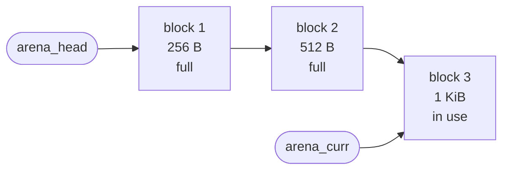
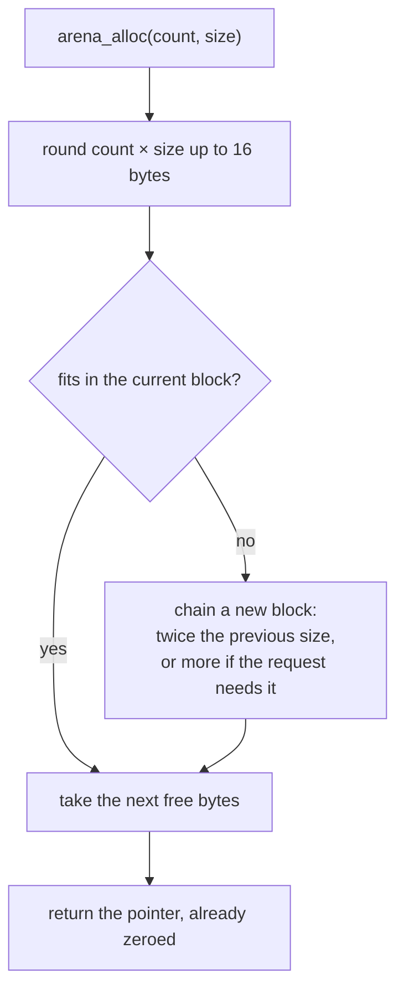

<div align="center">

# arena_allocator

**A tiny arena allocator in C, in one header.**
Allocate as much as you want, never free anything one by one, release everything with a single call.


</div>

---

## Why an arena

| | `malloc` / `free` per object | arena |
|---|---|---|
| allocate | one system call path per object | bump a pointer in a block it owns |
| free | one `free` per object, easy to forget | **one** `arena_free()` for everything |
| leaks | every missed `free` | impossible: blocks are freed together |
| memory | scattered | packed in a few big blocks |

It fits programs whose data lives until the end: compilers, parsers, interpreters, command line tools, one frame of a game.

---

## Quick start

```c
#include "header.h"

int main(void) {
    int  *numbers = arena_alloc(100, sizeof(int));  // zeroed, like calloc
    char *name    = arena_alloc(32, 1);

    // ... use them, allocate more, never free one by one ...

    size_t used = arena_free();                      // releases every block
    printf("used %zu bytes\n", used);
}
```

```bash
gcc main.c && ./a.out
```

There is nothing else to compile: `header.h` holds the whole implementation.

---

## API

| function | what it does |
|---|---|
| `void *arena_alloc(size_t count, size_t size)` | Returns zeroed memory for `count` items of `size` bytes, like `calloc`. Never returns `NULL`: it exits with a message when the system is out of memory. |
| `void arena_reserve(size_t size)` | Makes sure the next `size` bytes fit in the current block, so a batch of allocations doesn't start a new block halfway. |
| `size_t arena_free(void)` | Releases every block and returns how many bytes were used, block headers included. |

---

## How it works

Memory comes from **blocks chained in a list**. Each block knows its size and how much of it is used. `arena_head` is the first block, and `arena_curr` the one allocations come from.



Every allocation follows the same path:



+ **Alignment**: every size is rounded up to 16 bytes, so every pointer is 16-byte aligned.
+ **Growth**: the first block holds 256 bytes, and each new block is twice the size of the previous one, so a few blocks cover a lot of memory.

| block | 1 | 2 | 3 | 4 | 5 | 6 | 7 | 8 |
|---|---|---|---|---|---|---|---|---|
| size | 256 B | 512 B | 1 KiB | 2 KiB | 4 KiB | 8 KiB | 16 KiB | 32 KiB |
| total | 256 B | 768 B | 1.75 KiB | 3.75 KiB | 7.75 KiB | 15.75 KiB | 31.75 KiB | 63.75 KiB |

+ **Zeroed**: blocks come from `calloc`, so all memory starts at zero.

---

## Example

`main.c` counts the words of a sentence. Every word copy and every list node comes from the arena, and nothing is freed one by one.

```bash
$ gcc main.c && ./a.out
dog  1
and  1
mat  1
on   2
sat  2
cat  2
the  4
memory used: 368 bytes
```

---

## Limits

+ **No single free**: memory is only released all at once.
+ **Not thread safe**: the arena is one global list.
+ **One `.c` file**: `header.h` defines its functions, so include it in only one `.c` file of a program.
+ **Free once, at the end**: don't allocate after `arena_free()`. The list isn't reset, so the next allocation would use freed memory.

---

## History

This repository started as **Garbage_collector**: a list of every allocation, freed at the end. It is now an arena: far fewer calls to `malloc`, and no list to walk for each allocation.

---

<div align="center">

Made by **Mohammed Hrima** · [mohammedxhrima@gmail.com](mailto:mohammedxhrima@gmail.com)

</div>
